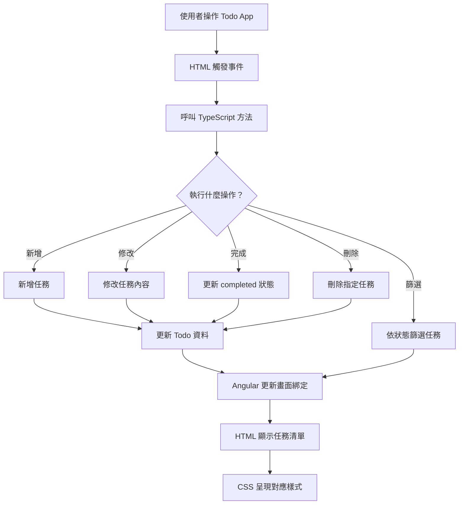

# Angular Todo Learning

## 專案介紹

這是我學習 Angular 與 TypeScript 時開發的 Todo App，透過實際操作理解 Angular 的資料綁定、事件處理、元件架構及資料管理。

## 使用技術

- Angular
- TypeScript
- HTML／CSS
- Git／GitHub

## 主要功能

- 新增任務
- 修改任務
- 刪除任務
- 切換完成狀態
- 篩選 All／Active／Completed

## 學習紀錄

### Week 1｜Angular 基礎

- Angular CLI 與專案結構
- JavaScript Array、Object、Function
- `filter()`、`map()`、`find()`
- Arrow Function、return
- Todo 資料操作

## 後續規劃

- Component 元件拆分
- Service 資料管理
- localStorage
- Routing
- API 串接
- 測試與部署

## 學習筆記

HackMD：待補上連結

## Todo App 資料流程圖

> 此圖為 Angular Todo App 的概念流程示意，實際程式架構以專案原始碼為準。
