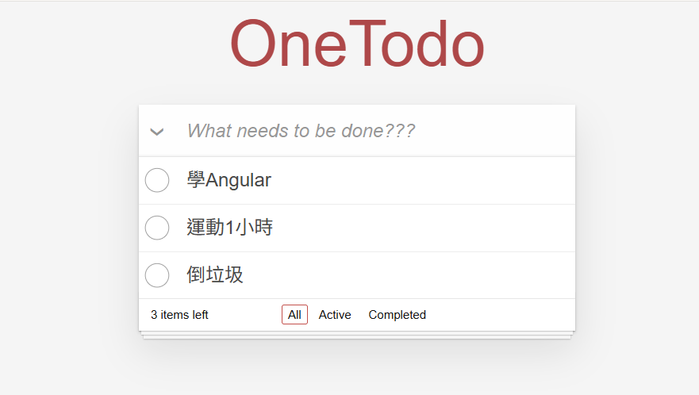
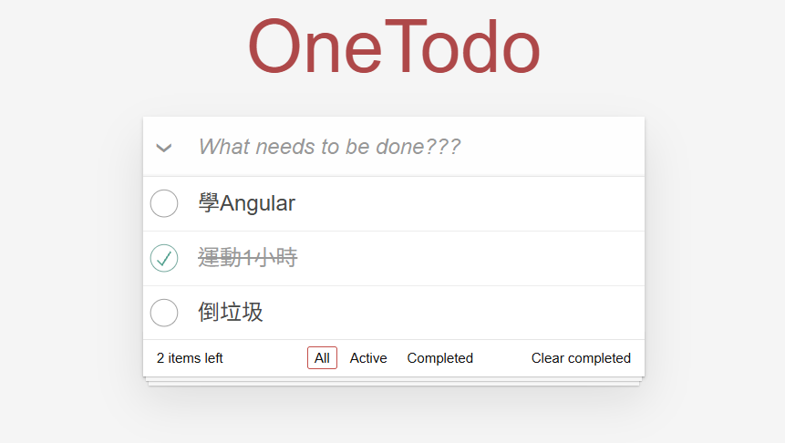
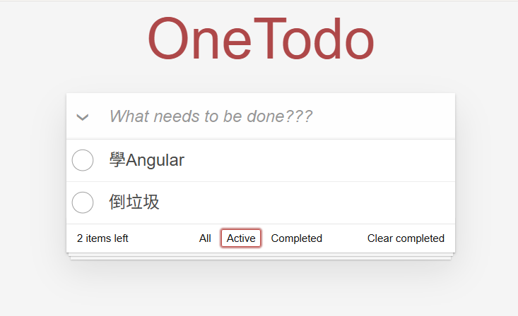
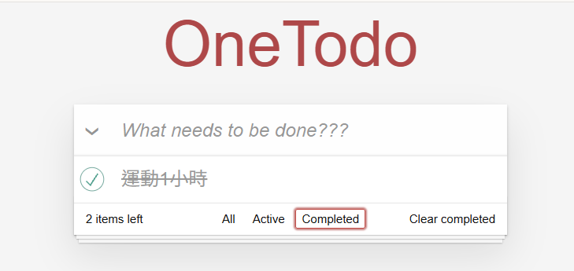
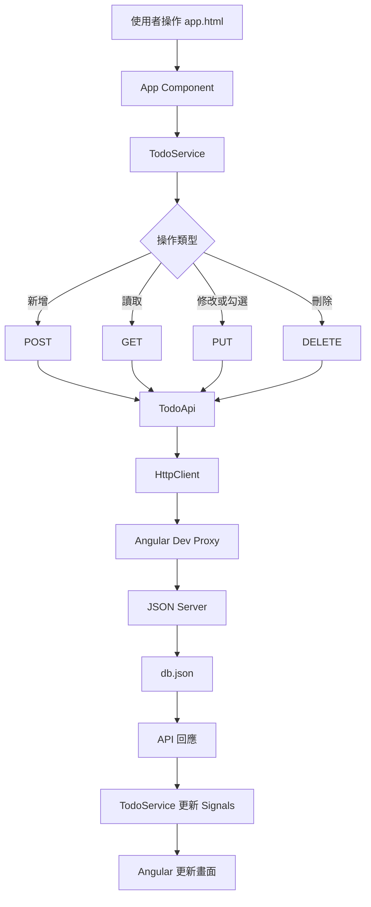

# OneTodo｜Angular Todo App

使用 **Angular 22、TypeScript 與 JSON Server** 開發的待辦事項管理應用程式，支援任務新增、編輯、刪除、完成狀態切換及條件篩選。

專案從基本的 Angular 資料綁定與事件處理開始，逐步加入 REST API 串接、Signals 狀態管理，並將程式拆分為 Component、TodoService 與 TodoApi，練習前端應用程式的分層設計與資料管理。

> 本專案為個人 Angular 實作作品，目前使用 JSON Server 模擬後端，持續優化功能與程式架構。

---

## 📸 專案展示

### 主畫面



### 功能展示

| 展示畫面一 | 展示畫面二 |
|---|---|
|  |  |

### 其他操作畫面



---

## ✨ 核心功能

### 任務管理

- **新增任務**：輸入待辦事項並按 Enter 新增。
- **編輯任務**：雙擊任務文字進入編輯模式。
- **刪除任務**：刪除指定待辦事項。
- **完成狀態切換**：勾選或取消勾選任務。
- **全選／取消全選**：一次更新所有任務的完成狀態。
- **清除已完成**：批次移除已完成事項。
- **任務數量統計**：顯示目前尚未完成的任務數量。

### 任務篩選

| 篩選條件 | 功能 |
|---|---|
| All | 顯示全部任務 |
| Active | 顯示尚未完成的任務 |
| Completed | 顯示已完成的任務 |

### 資料儲存

透過 Angular HttpClient 與 JSON Server 溝通，將任務資料儲存在模擬後端中，而不是只保存在前端陣列。

支援使用 GET、POST、PUT、DELETE 進行資料操作，讓任務的新增、修改與刪除結果可以持續保留。

---

## 🛠️ 技術與工具

| 分類 | 使用技術 | 應用方式 |
|---|---|---|
| 前端框架 | Angular 22 | Standalone Component、畫面與事件處理 |
| 程式語言 | TypeScript、JavaScript | 資料型別、方法與應用邏輯 |
| 網頁樣式 | HTML、CSS | TodoMVC 畫面與互動樣式 |
| 狀態管理 | Angular Signals | 待辦清單的響應式資料更新 |
| 元件架構 | Component、Service | 分離畫面、業務邏輯與 API 操作 |
| API 通訊 | Angular HttpClient | 發送 REST API 請求 |
| 模擬後端 | JSON Server 1.0.0-beta.15 | 模擬資料讀寫與持久化 |
| 開發工具 | VS Code、Node.js、npm | 開發環境及套件管理 |
| 版本控制 | Git、GitHub | 版本追蹤與專案管理 |

---

## 🏗️ 專案架構

專案採用分層架構，將畫面操作、資料管理與 HTTP 請求分開處理，降低元件與後端通訊邏輯之間的耦合。

```text
todo/
├── public/
│   ├── assets/                  # 靜態資源
│   ├── vanillajs/               # 練習參考資源
│   ├── todo-preview-1.png       # 專案展示圖
│   ├── todo-preview-2.png
│   ├── todo-preview-3.png
│   └── todo-preview-4.png
│
├── src/
│   ├── app/
│   │   ├── @models/
│   │   │   └── todo.model.ts    # Todo 資料介面與狀態列舉
│   │   │
│   │   └── @services/
│   │       ├── todo.ts          # 任務狀態與業務邏輯
│   │       └── todo-api.ts      # HTTP API 請求
│   │
│   ├── proxy.conf.json         # 開發環境 API Proxy
│   └── styles.css              # 全域樣式
│
├── angular.json                # Angular 專案設定
├── package.json                # 套件與執行指令
└── README.md
```

### 各層職責

**App Component — 畫面與事件處理**

- 接收使用者輸入與操作。
- 呼叫 TodoService 執行任務操作。
- 透過資料綁定顯示任務清單與篩選結果。

**TodoService — 資料與業務邏輯**

- 管理待辦事項清單。
- 處理新增、編輯、刪除及完成狀態。
- 管理 All／Active／Completed 篩選。
- 使用 Signals 更新資料狀態。

**TodoApi — 後端通訊**

- 集中管理 API 路徑。
- 使用 HttpClient 發送 HTTP 請求。
- 與 JSON Server 交換資料。

---

## 🔄 資料流程



任務篩選等不需要修改後端資料的操作，則直接透過 TodoService 處理前端狀態。

### REST API 操作

| HTTP Method | Endpoint | 說明 |
|---|---|---|
| GET | `/todo2_16` | 取得全部任務 |
| POST | `/todo2_16` | 新增任務 |
| PUT | `/todo2_16/:id` | 更新指定任務 |
| DELETE | `/todo2_16/:id` | 刪除指定任務 |

全選與清除已完成事項採用逐筆更新或刪除的方式，配合目前 JSON Server 的標準 REST API。

---

## 💡 實作重點與技術挑戰

### 1. 從單一 Component 拆分為 Service 架構

初期將所有待辦事項的狀態、操作及 API 請求集中寫在 `app.ts`。

隨著功能增加，逐步拆分成 Component、TodoService 與 TodoApi，讓各層有明確的職責，提升程式碼可讀性與後續維護便利性。

### 2. 處理非同步資料與畫面更新

在使用 HttpClient 取得 JSON 資料時，曾遇到 API 成功回傳，但 Angular 畫面沒有同步更新的問題。

初期透過 `ChangeDetectorRef.markForCheck()` 處理，後續進一步練習 Angular Signals，使用 `signal()`、`set()` 與 `update()` 管理清單資料。

### 3. 新舊 JSON Server 的相容性

教學範例使用舊版後端及自訂 API，而目前使用 JSON Server 1.0.0-beta.15。

因此重新調整資料識別欄位，使用 `id` 管理任務，並將部分原本依賴自訂端點的操作，改為透過標準 REST API 執行。

### 4. Proxy 與 API 連線問題

在前後端串接過程中，曾遇到 HTTP 404、502、`ECONNREFUSED` 等錯誤。

透過檢查 API 路徑、Proxy 設定、後端服務狀態與瀏覽器開發者工具，逐步定位問題並完成串接。

### 5. Angular SSR 與 CSR 的差異

開發過程曾遇到 SSR 執行環境與瀏覽器專用函式庫的相容性問題。

考量本專案目前以使用者互動及 REST API 練習為主，調整為 CSR（Client-Side Rendering）模式，簡化開發環境。

---

## 🚀 本機執行方式

本專案的前端與 JSON Server 分開執行，需要同時啟動兩個服務。

### 1. Clone 專案

```bash
git clone https://github.com/zoe12378/angular-todo.git
cd angular-todo
```

### 2. 安裝依賴套件

```bash
npm install
```

### 3. 啟動 JSON Server

目前後端資料庫獨立於 Angular 專案，需要另外建立 JSON Server 執行環境。

安裝：

```bash
npm install -g json-server@1.0.0-beta.15
```

建立 `db.json`：

```json
{
  "todo2_16": [
    {
      "id": "1",
      "Thing": "學習 Angular",
      "Status": false,
      "Editing": false
    },
    {
      "id": "2",
      "Thing": "完成 Todo App",
      "Status": true,
      "Editing": false
    }
  ]
}
```

在 `db.json` 所在目錄啟動：

```bash
json-server db.json
```

後端預設執行於：

```text
http://localhost:3000
```

資料端點：

```text
http://localhost:3000/todo2_16
```

### 4. 確認 Proxy 設定

Angular 透過 `src/proxy.conf.json` 將開發環境中的 API 請求轉送至本機 JSON Server。

請確認 Proxy 的目標網址、路徑規則及前端 API 路徑一致。

### 5. 啟動 Angular

另外開啟終端機：

```bash
npm start
```

瀏覽器開啟：

```text
http://localhost:4200/
```

**注意：** 若沒有啟動 JSON Server，前端將無法正常取得待辦事項資料。

---

## 📚 開發歷程

專案依照實作進度逐步擴充：

1. **Angular 基礎**：建立專案、認識 TypeScript、資料綁定及事件處理。
2. **Todo CRUD**：完成新增、編輯、刪除、勾選及狀態篩選。
3. **後端串接**：使用 HttpClient、Proxy、JSON Server 完成 REST API 資料操作。
4. **架構重構**：將 API、資料操作及畫面邏輯拆分至不同 Service。
5. **響應式狀態管理**：練習 Angular Signals 與非同步資料更新。

---

## 📈 後續優化方向

- [ ] 完善 API 請求失敗時的錯誤提示及狀態還原。
- [ ] 加入 Loading 狀態，改善資料讀取體驗。
- [ ] 深入學習 RxJS Observable 及常用運算子。
- [ ] 學習 Component 之間的資料傳遞。
- [ ] 加入表單驗證與輸入檢查。
- [ ] 學習 Angular Routing 與 Reactive Forms。
- [ ] 撰寫單元測試。
- [ ] 規劃前後端部署與線上 Demo。

---

## 📝 學習筆記

HackMD：待補上連結

---

**OneTodo** 是個人 Angular 實作與技術練習專案，透過持續開發、除錯與重構，累積 TypeScript、Angular 元件設計、前端狀態管理與 API 串接的實務經驗。